<p align="center">
  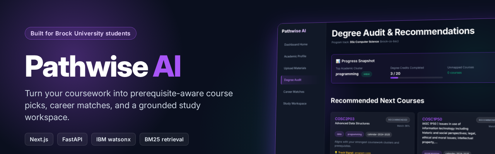
</p>

<h1 align="center">Pathwise AI</h1>

<p align="center">
  <b>A student pathway engine for Brock University.</b><br>
  Turn your transcript into prerequisite-aware course picks, career matches, and a study workspace grounded in your own notes.
</p>

<p align="center">
  
  
  
  
  
  
  
</p>

<p align="center">
  <a href="#demo">Demo</a> &bull;
  <a href="#features">Features</a> &bull;
  <a href="#tech-stack">Tech Stack</a> &bull;
  <a href="#quick-start">Quick Start</a> &bull;
  <a href="#api">API</a> &bull;
  <a href="#team">Team</a>
</p>

> [!IMPORTANT]
> Pathwise AI is decision-support only. It is not official Brock academic advising or a degree audit system. Always verify prerequisites, restrictions, and program requirements with official Brock resources. Course data is a frozen 2024-25 snapshot and may be incomplete or outdated.

---

## Demo

All GIFs below were recorded from the app running locally **without IBM credentials**, using the sample transcript and notes in [`assets/samples/`](assets/samples/) (demo data, not a real student).

### 1. Build a profile from a transcript PDF
Enter a student ID and goals, drop in an unofficial transcript PDF, and Pathwise pulls out every course code and grade into an editable table. Tweak confidence and enjoyment, then generate the audit.

<p align="center">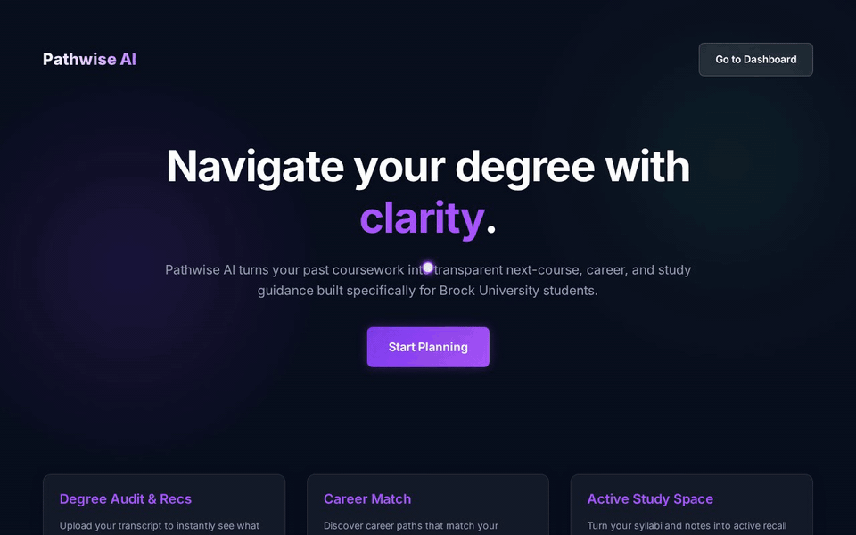</p>

### 2. Prerequisite-aware course recommendations
Every eligible next course is checked against the prerequisite graph and scored against your strongest coursework clusters, with a match percentage and a label (Recommended, Challenge, or Prereqs Missing).

<p align="center"></p>

### 3. Career matches
Your courses are mapped onto skill clusters and weighted against career profiles, showing fit scores and the specific courses that would strengthen each path.

<p align="center">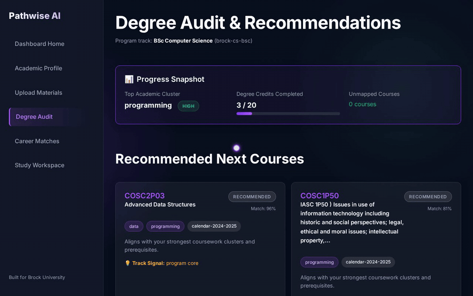</p>

### 4. Study workspace
Upload course PDFs, then generate study material and ask questions about the document. Modes: Summary, Feynman Mode, Flashcards, Active Recall, and Blurting.

<p align="center">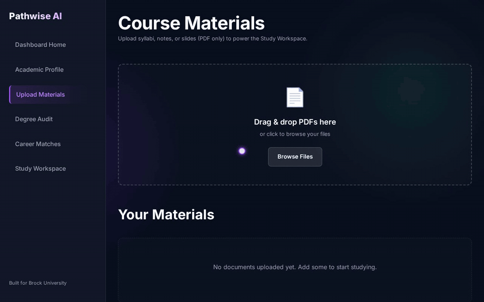</p>

> [!NOTE]
> Without watsonx credentials the study workspace uses its built-in deterministic fallback (extractive text from your PDF), which is what the GIF shows. With `WATSONX_API_KEY` and `WATSONX_PROJECT_ID` set, the same screens are generated by Llama 3.3 70B on IBM watsonx.

---

## Screenshots

| Landing page | Dashboard |
|---|---|
| 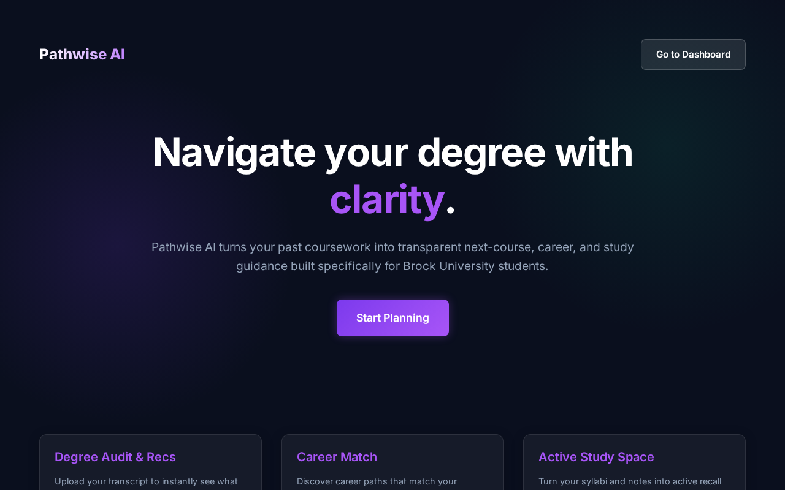 | 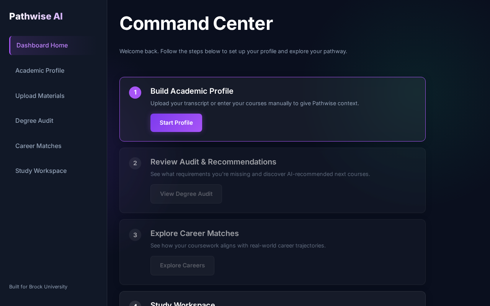 |

| Transcript import | Degree audit |
|---|---|
| 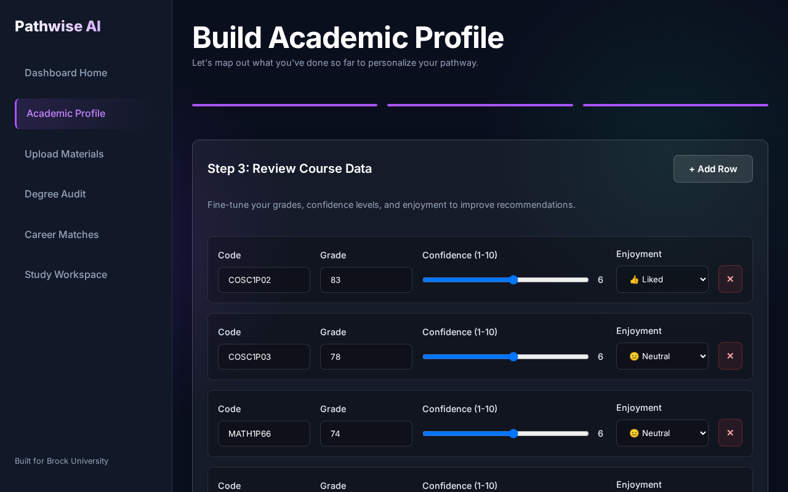 | 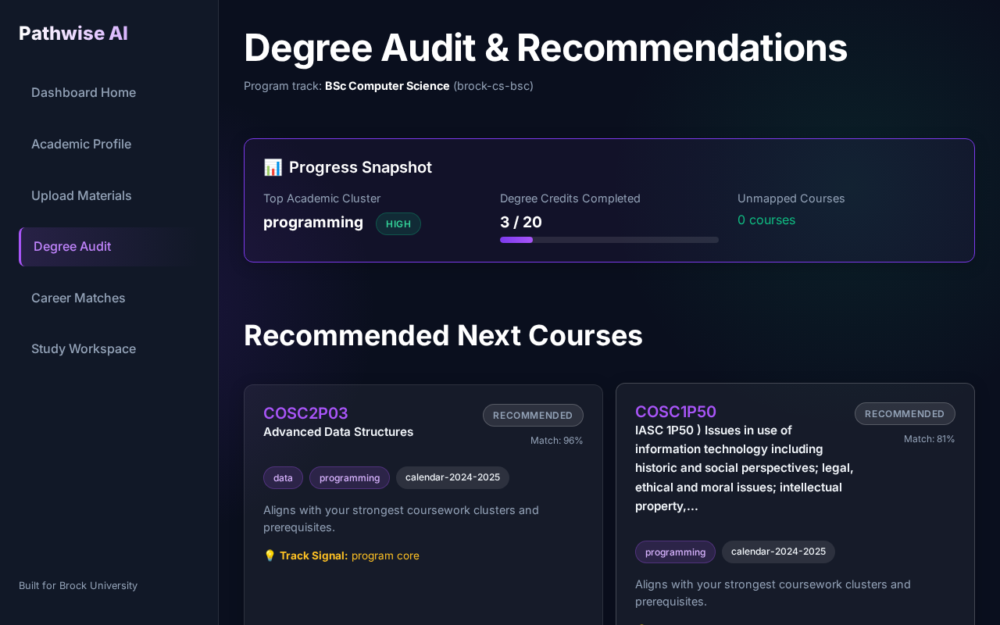 |

| Career matches | Upload materials |
|---|---|
| 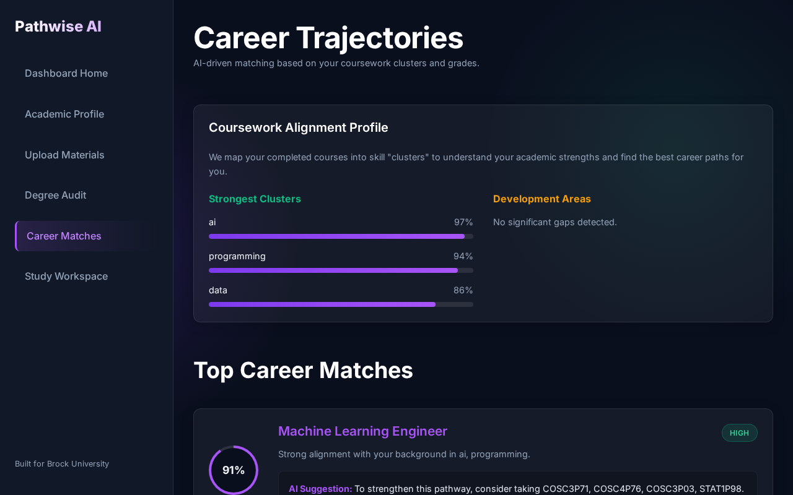 | 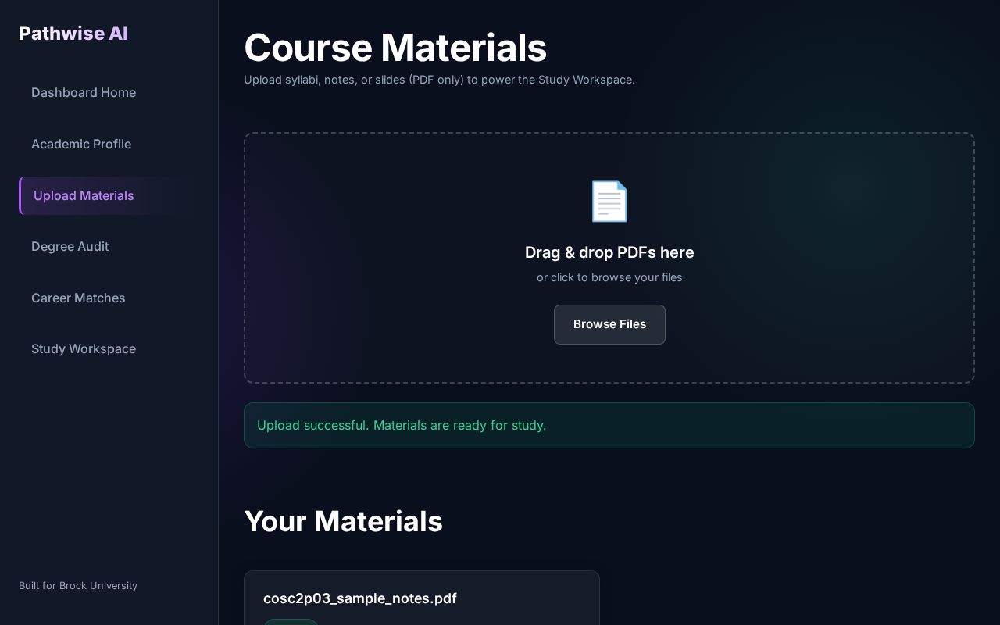 |

| Study workspace | API docs (Swagger) |
|---|---|
| 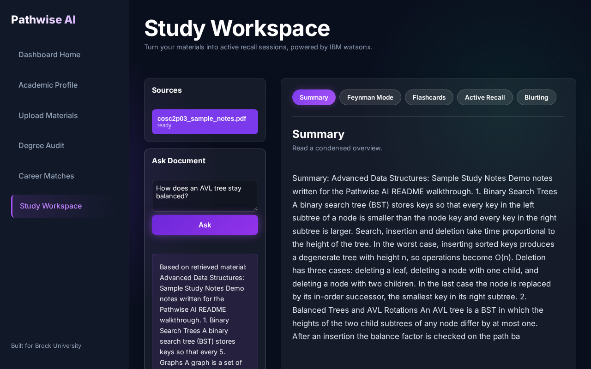 | 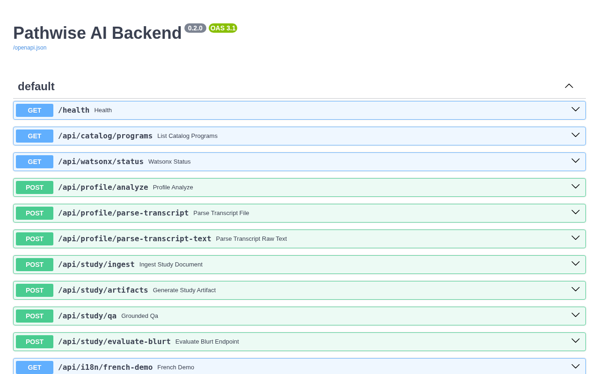 |

---

## Features

### Course recommendations
- Enter completed courses by hand or upload a transcript (PDF parsed locally, screenshots read by a watsonx vision model).
- A deterministic engine checks every candidate course against required courses, one-of groups, corequisites, grade minimums, and program restrictions.
- Each pick gets a match score from your cluster strengths, grades, confidence, and enjoyment, plus a label: **Recommended** (safe), **Challenge** (stretch), or **Prereqs Missing** (risky).
- Program tracks: BSc Computer Science, Bachelor of Business Administration, or an "All disciplines" explore mode.
- Progress snapshot with your top academic cluster and credits completed.

### Career path matching
- Coursework is mapped onto skill clusters (for example ai, programming, data, systems).
- Matched against four career profiles: Software Engineer, Data Analyst, Machine Learning Engineer, and Security Analyst.
- Each match shows a fit score, a confidence badge, and the courses that would close the gap.

### Study workspace
- Upload PDFs (syllabi, notes, slides). Text is extracted locally with pypdf, or with IBM Document Understanding if configured, then chunked with page and section metadata.
- BM25 retrieval with page-spread sampling so long PDFs are not summarized from page 1 only.
- Five modes: Summary, Feynman Mode (concept breakdown), Flashcards (from a glossary), Active Recall (self-test), and Blurting (write what you remember, then get feedback and a score).
- "Ask Document" for questions answered from your upload, with citation metadata (source file and page) returned by the API.

### Works without API keys
Prerequisite checking, scoring, career matching, and PDF transcript import all run with no IBM credentials. Summary, concept breakdown, self-test, and Ask Document fall back to deterministic extractive output when watsonx is not configured. Blurting feedback and transcript screenshot (image) OCR need watsonx.

---

## Tech Stack

| Layer | Technology |
|---|---|
| Frontend | Next.js 14 (App Router), React 18, TypeScript, react-markdown |
| Backend | FastAPI, Pydantic, Uvicorn, Python 3.13 |
| LLM | IBM watsonx, Llama 3.3 70B Instruct (text) |
| Vision OCR | IBM watsonx, Llama 3.2 11B Vision Instruct (transcript screenshots) |
| Retrieval | BM25 (rank-bm25) |
| PDF parsing | pypdf (local), IBM Document Understanding (optional) |
| Data | Frozen JSON from the Brock 2024-25 calendar: 325 courses (MATH, COSC, ACTG, MKTG, STAT and more), 3 program tracks, 4 career profiles |
| Tests | pytest |

---

## Project Structure

```
.
├── frontend/                  # Next.js + TypeScript app
│   ├── app/
│   │   ├── page.tsx           # Landing page
│   │   └── dashboard/
│   │       ├── profile/       # Academic profile and transcript upload
│   │       ├── audit/         # Course recommendations
│   │       ├── careers/       # Career path matches
│   │       ├── upload/        # PDF upload
│   │       └── study/         # Study workspace
│   ├── components/
│   └── lib/api/               # Typed API client
└── backend/                   # FastAPI app
    ├── app/
    │   ├── main.py            # API routes
    │   ├── engine.py          # Prerequisite logic and scoring
    │   ├── watsonx_client.py  # IBM watsonx IAM, text and vision generation
    │   ├── study_service.py   # BM25 retrieval and artifact generation
    │   ├── doc_understanding.py
    │   └── transcript_parser.py
    ├── data/                  # courses.json, programs.json, career_paths.json
    └── tests/
```

---

## Quick Start

Tested on Linux with Python 3.13 and Node.js 24.

### 1. Backend

```bash
cd backend
python -m venv .venv
source .venv/bin/activate        # Windows: .venv\Scripts\Activate.ps1
pip install -r requirements.txt
cp .env.example .env
uvicorn app.main:app --host 127.0.0.1 --port 8000
```

API: `http://127.0.0.1:8000` and Swagger docs at `http://127.0.0.1:8000/docs`.

> [!TIP]
> No IBM account? That is fine. Either leave the placeholder values or blank out `WATSONX_API_KEY` and `WATSONX_PROJECT_ID` in `backend/.env`. The backend reports watsonx as not ready and uses its deterministic fallbacks.

### 2. Frontend

```bash
cd frontend
echo "NEXT_PUBLIC_API_BASE_URL=http://localhost:8000" > .env.local
npm install
npm run dev
```

Open `http://localhost:3000`. If you open the app at `127.0.0.1:3000` instead, set `NEXT_PUBLIC_API_BASE_URL=http://127.0.0.1:8000` so the origins match (otherwise you get CORS errors).

### 3. Try it

1. **Academic Profile**: enter an ID, click *Next*, and upload [`assets/samples/sample_unofficial_transcript.pdf`](assets/samples/sample_unofficial_transcript.pdf).
2. Click **Generate Degree Audit**, then open **Career Matches**.
3. **Upload Materials**: add [`assets/samples/cosc2p03_sample_notes.pdf`](assets/samples/cosc2p03_sample_notes.pdf).
4. **Study Workspace**: generate a summary and ask a question.

### Running tests

```bash
cd backend
python -m pytest
```

Covers prerequisite edge cases (restrictions, corequisites, grade minimums), scoring determinism, transcript parsing, the study pipeline, and API contracts.

---

## IBM watsonx Setup (optional)

Set these in `backend/.env` for full LLM behaviour:

```env
WATSONX_API_KEY=
WATSONX_PROJECT_ID=
WATSONX_URL=https://ca-tor.ml.cloud.ibm.com
WATSONX_MODEL_ID=meta-llama/llama-3-3-70b-instruct
WATSONX_VISION_MODEL_ID=meta-llama/llama-3-2-11b-vision-instruct

# Optional: IBM Document Understanding for PDF extraction
DOC_UNDERSTANDING_PROVIDER=local   # "ibm" if you have DU credentials
IBM_DU_API_KEY=
IBM_DU_URL=
```

---

## API

| Method | Endpoint | Description |
|---|---|---|
| `GET` | `/health` | Health check |
| `GET` | `/api/catalog/programs` | Available program tracks |
| `GET` | `/api/watsonx/status` | watsonx readiness and model IDs |
| `POST` | `/api/profile/analyze` | Prerequisite-checked recommendations and career matches |
| `POST` | `/api/profile/parse-transcript` | Extract courses from a transcript PDF or image |
| `POST` | `/api/profile/parse-transcript-text` | Extract courses from raw transcript text |
| `POST` | `/api/study/ingest` | Upload and chunk a PDF into a study session |
| `POST` | `/api/study/artifacts` | Generate summary, concept breakdown, glossary, self-test, or study guide |
| `POST` | `/api/study/qa` | Question answering over the session with citation metadata |
| `POST` | `/api/study/evaluate-blurt` | Score a "blurting" recall attempt against the material |
| `GET` | `/api/i18n/french-demo` | French translation pipeline demo |
| `POST` | `/api/study/tts` | Optional Watson Text to Speech |

---

## Roadmap

- French language support for multilingual documents
- Watson Text to Speech for study artifacts
- Live Brock calendar data instead of a frozen snapshot
- Full degree audit (remaining credits toward graduation)
- Multi-university support

---

## Team

| | Contributor | Contributions |
|---|---|---|
|  | **Ayaan Rathod** ([@AyaanRathod](https://github.com/AyaanRathod)) | Full-stack build: FastAPI backend, pathway engine, watsonx integration, study pipeline, Next.js frontend, tests |
|  | **Param** ([@paramp16](https://github.com/paramp16)) | Project README and documentation |

<p align="center"><sub>Built at the UNSA hackathon for Brock University students.</sub></p>
